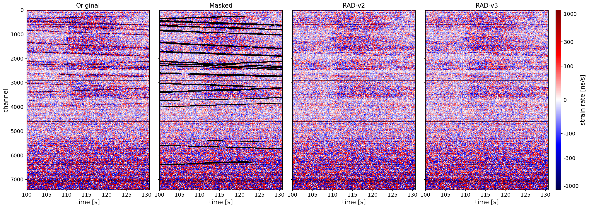

# Diffusion-Based DAS Inpainting

Removal of traffic signals from Distributed Acoustic Sensing (DAS) recordings with diffusion models.
Traffic is masked out and the masked region is inpainted, so that earthquake signals underneath are preserved.

Two approaches are compared:

- **RAD (Region-Aware Diffusion)**: a U-Net conditioned on a per-pixel noise-level map and trained directly for inpainting
  (two-phase forward process: phase 1 noises only the hole, phase 2 the rest).
- **RePaint**: zero-shot inpainting with unconditional DDPM priors (SSA, SPCII and Mamba U-Nets), the known region is
  re-inserted at every denoising step.



*Traffic removal with RAD on a 30 s recording over the whole cable: original, automatic traffic mask (black)
and inpainted results of RAD v2 and v3. Traffic lines are removed while the earthquake arrival is preserved.*

## Installation

Python >= 3.10 and a CUDA GPU are required (training and sampling were run on an NVIDIA A100).

```bash
git clone https://github.com/Islem-dh/diffusion-based-das-inpainting.git
cd diffusion-based-das-inpainting
pip install -r requirements.txt
pip install -e .
```

`pip install -e .` installs the package `ddpm` from `src/`, so `import ddpm` works in scripts and notebooks from any folder.

`mamba_ssm` is only needed for the Mamba U-Net. It builds on Linux with CUDA only and compiles during installation.
Without it, RAD, SSA and SPCII still work; remove the line from `requirements.txt` in that case.

## Data

The DAS data come from the SISSLE experiment (DAS array crossing the Alpine Fault near Haast, New Zealand).
The data are not part of this repository.

- **Patches** (`train_NPME.h5`, `test_NPME.h5`): windows of 256 channels × 512 time samples (100 Hz, about 5 s),
  normalized with `arcsinh(x / 50) / arcsinh(12350 / 50)`.
  The code NPME describes the content: **N** background noise, **P**/**M** traffic along / against the cable direction, **E** earthquake.
  Priors and RAD are trained on `1001` (noise + earthquake); traffic removal is tested on `1111`.
- **Raw recordings** (1-minute files, 100 Hz, 7488 channels): used for the long-segment test in `notebooks/geo_rad.ipynb`.

Default paths are set in `src/ddpm/paths.py` and can be overridden with environment variables:

```bash
export DAS_DATA=/path/to/SISSLE_south30          # folder with train/test_NPME.h5
export DAS_RAW=/path/to/SISSLE_100Hz/south30      # raw recordings
export DDPM_ROOT=/path/to/project                 # only if the project is not used from its own folder
```

**Convention:** all tensors are `[batch, 1, channels, time]`; masks use `1 = keep`, `0 = hole`.

## Training

One script per final model. Each script resumes from its checkpoint if it exists and saves to `checkpoints/`.

| Script | Model | Epochs |
|---|---|---|
| `scripts/train_prior_ssa.py` | DDPM prior, SSA U-Net, trained on 1001 | 40 |
| `scripts/train_prior_spcii.py` | DDPM prior, SPCII U-Net, trained on 1001 | 40 |
| `scripts/train_prior_mamba.py` | DDPM prior, Mamba U-Net, trained on 1001 | 40 |
| `scripts/train_prior_mamba_50_50.py` | DDPM prior, Mamba U-Net, 50 % noise-only (1000) + 50 % noise + earthquake (1001) | 20 |
| `scripts/train_rad_v1.py` | RAD v1: MSE on all pixels, uniform timesteps | 40 |
| `scripts/train_rad_v2.py` | RAD v2: fine-tuning of v1 with EMA, masked MSE, phase-1 focus (**needs v1**) | 40 + 20 |
| `scripts/train_rad_v3.py` | RAD v3: from scratch with EMA, masked MSE, phase-1 focus, input scaling | 40 |

```bash
python scripts/train_rad_v3.py
# long runs in the background:
nohup python scripts/train_rad_v3.py > logs/train_rad_v3.log 2>&1 &
```

RAD v3 reads the input scaling factor from `checkpoints/data_scaling.json` (computed in `notebooks/scaling_factor.ipynb`).

Training is not seeded, so a new run gives a model with the same setup but not identical weights.

## Notebooks

Experiments and evaluation are in `notebooks/`. See [`notebooks/README.md`](notebooks/README.md)
for which notebook contains which experiment. Result figures are in `outputs/`.
